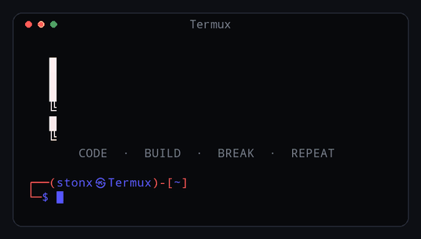

# STONX Banner

Your name in big block letters at the top of Termux, with a grey tagline under it.

اسمك بحروف بلوكات كبيرة فوق شاشة Termux، وتحته سطر رمادي.

<p align="center"></p>

## Install / التثبيت

One command. It installs, then opens a fresh shell with the banner:

أمر واحد بيثبت ويشغل:

```bash
curl -fsSL https://raw.githubusercontent.com/stonxmg-lang/stonx-banner/main/install.sh | bash && exec bash
```

With your name straight away / باسمك على طول:

```bash
curl -fsSL https://raw.githubusercontent.com/stonxmg-lang/stonx-banner/main/install.sh | bash -s -- "AHMED" && exec bash
```

## Commands / الأوامر

| Command | What it does |
|---|---|
| `stonx` | show the banner again / يظهر الشعار تاني |
| `stonx name AHMED` | change the name / يغير الاسم |
| `stonx tagline "TEXT"` | change the grey line (`stonx tagline off` hides it) / يغير السطر الرمادي |
| `stonx theme blue` | `red` `blue` `green` `purple` `orange` `cyan` `pink` `gold` |
| `stonx prompt on\|off` | use the STONX prompt or keep your own / البرومبت |
| `stonx off` / `stonx on` | turn the banner off / on |
| `stonx preview` | print the banner once |
| `stonx update` | get the latest version / تحديث |
| `stonx version` | show the installed version / رقم النسخة |
| `stonx uninstall` | remove everything / حذف |

`clear` and `Ctrl+L` wipe the screen and bring the banner straight back.

## How it fits any screen

- The name uses the big letters when they fit, otherwise it moves to two lines,
  then to a smaller block font, so it never gets cut off on a phone.
- It re-fits itself live when you rotate or pinch-zoom.
- It animates for the first few minutes, then stops to save battery.
- It stops the moment you run a command, so it never draws over your output.

Names can use `A-Z`, `0-9`, spaces and `- . ! ? _ & @ #`. Anything else (Arabic
letters, emoji) can't be drawn by the block font: `stonx name` tells you which
characters it will skip.

الاسم لازم يكون بحروف إنجليزية أو أرقام. لو كتبت حروف عربي أو إيموجي، الأمر هيقولك إنها مش هتظهر.

## Files

```
~/.stonx-banner/          the program (a git clone)
~/.config/stonx/config    your settings: NAME, TAGLINE, THEME, PROMPT, ENABLED
~/.bashrc                 one line ending in "# stonx-banner"
```

## Preview image

`docs/preview.gif` is drawn by the real banner code: `python3 tools/make_preview.py` (needs Pillow).

## Credits

Big letters: the "ANSI Shadow" FIGlet font. Mid-size letters: "Pagga" by Sam Hocevar (WTFPL).

MIT License.
